# Atelier

Atelier es un editor 3D de chromas para League of Legends. Abre una skin, cambia el color de sus piezas y efectos, compara el resultado con el original y expórtalo como archivo `.fantome` para esa misma skin.

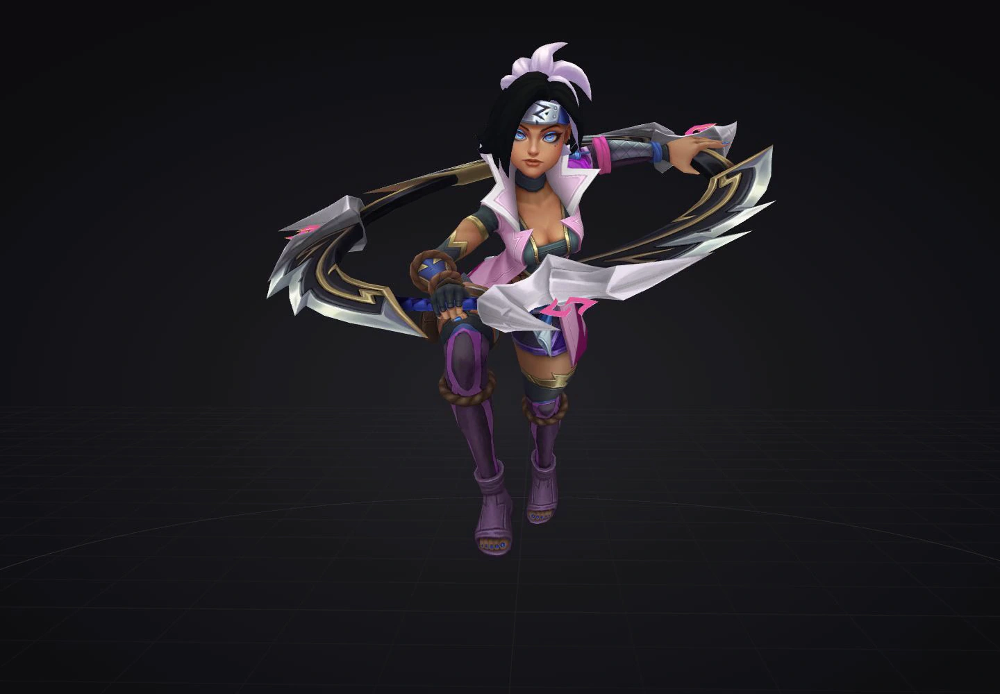

El catálogo corresponde al parche **26.23** e incluye **173 campeones y 2.135 skins**. El editor se ejecuta en local y puede usarse sin conexión después de instalar los recursos.

## Estado en partida

**26 de noviembre de 2026.** El editor permite previsualizar y exportar chromas. Cargarlos en una partida depende de la compatibilidad del gestor de mods con el parche del juego y la versión de Vanguard.

Riot anunció restricciones al acceso directo a la memoria del juego por aplicaciones de terceros. League Toolkit informó el 25 de noviembre de que Vanguard `1.19.3.22` y `1.19.3.23` impedían que su patcher se cargara en los equipos afectados. En esos equipos, el gestor puede aceptar un archivo `.fantome` aunque el chroma no aparezca en partida. [Aviso oficial de Riot](https://support.riotgames.com/en-us/riot/performance/game-memory-access-removed-for-third-party-apps) · [Comunicado de League Toolkit](https://github.com/orgs/LeagueToolkit/discussions/1101)

## Instalación local

Necesitas Node.js 24 o posterior, Git, un navegador con WebGL y unos **22 GB libres** para guardar la descarga y los recursos extraídos. El instalador descarga automáticamente unos **10,4 GB** de modelos, texturas, máscaras, animaciones y archivos de exportación. Puedes clonar el repositorio e instalar estos recursos sin iniciar sesión en GitHub. [Release de recursos](https://github.com/uldrens0v/atelier/releases/tag/v1.0.0-local)

```sh
git clone https://github.com/uldrens0v/atelier.git
cd atelier
npm run assets:install
npm start
```

Con el servidor en marcha, abre [Atelier en local](http://127.0.0.1:8789/pieces.html). Puedes editar y exportar aunque League of Legends no esté instalado en ese equipo.

Si ya descargaste los archivos de la Release, guarda `asset-bundle.json` y los diez archivos `.tar` en la misma carpeta e indica su ruta al instalador.

```sh
npm run assets:install -- --from "./archivos-atelier"
```

El instalador verifica las sumas SHA-256. Si se interrumpe, vuelve a ejecutar el mismo comando para completar lo que falte. Usa `ATELIER_ASSETS_DIR` para elegir otra ubicación de recursos y conserva ese valor al instalar y al arrancar. `ATELIER_PORT` cambia el puerto del servidor local.

## Guía del editor

### Elegir campeón y skin

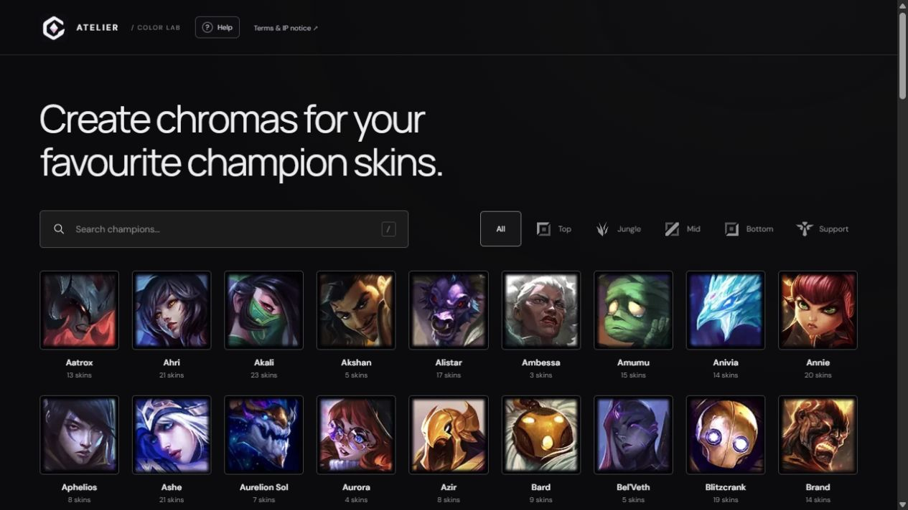

Busca al campeón por nombre o filtra por posición. Pulsa su retrato para ver las ilustraciones de sus skins y elige una para abrir el visor 3D.

### Recolorear el modelo

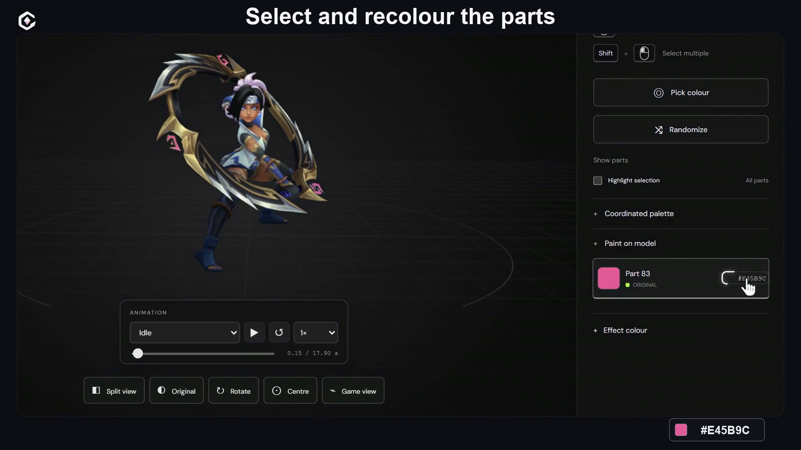

Haz clic en una pieza para editarla. El panel permite ajustar su color mediante HEX. En la imagen, `#E45B9C` tiñe de rosa la gema del arma de Qiyana.

| Control | Acción |
| --- | --- |
| Clic | Selecciona una pieza. |
| Shift + clic | Añade otra pieza a la selección. |
| Ctrl + arrastrar | Selecciona las piezas de un rectángulo. |
| Ctrl + Shift + arrastrar | Añade las piezas del rectángulo a la selección actual. |

### Comparar con el original

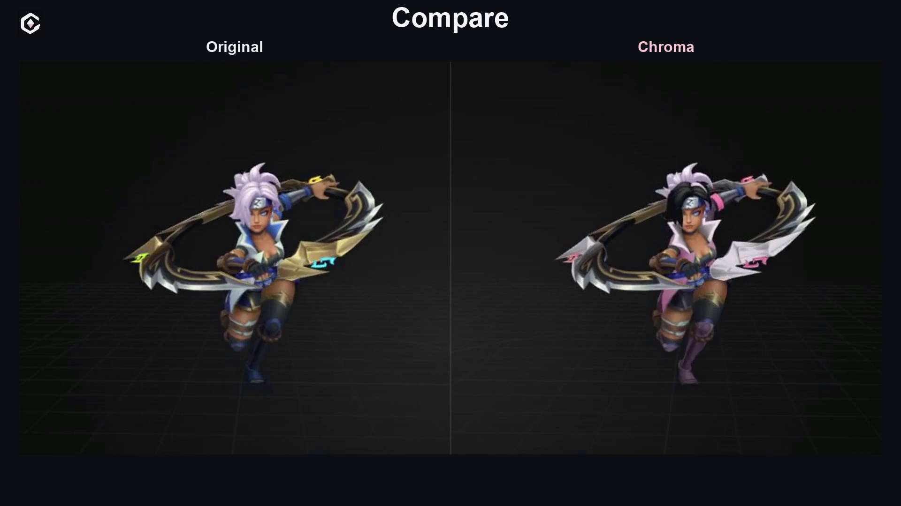

**Split view** coloca el original a la izquierda y el chroma a la derecha. La skin se abre en su pose base. Al elegir una animación, ambas versiones la reproducen sincronizadas para comparar el color en movimiento.

### Editar formas alternativas

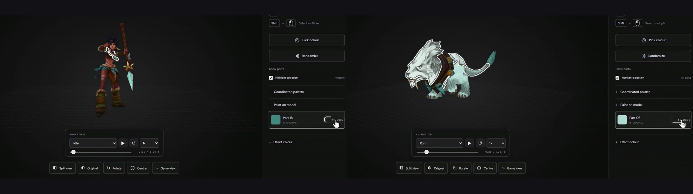

El selector **Form** alterna entre los modelos disponibles. En Nidalee puedes asignar colores por separado a la forma humana y a la felina. En el panel de habilidades, **Change form** muestra el conjunto de habilidades de la otra forma cuando está disponible.

### Recolorear efectos de habilidades

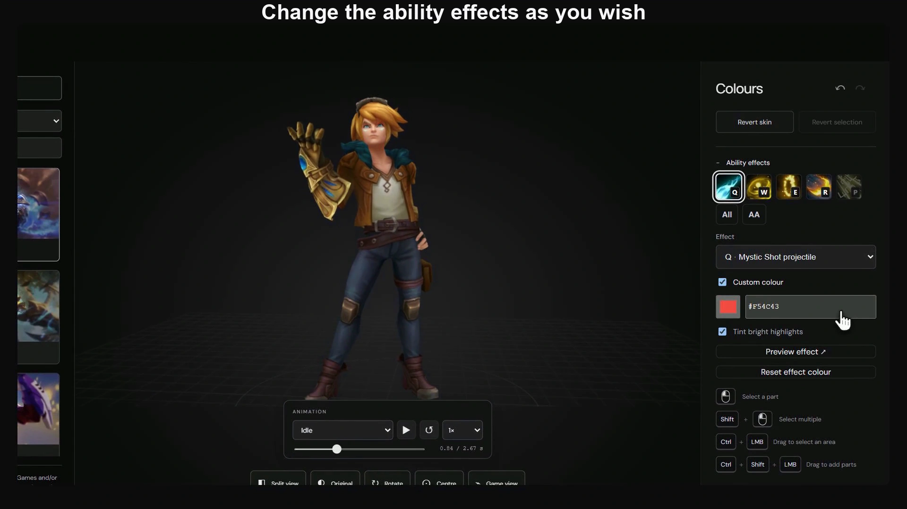

En **Ability effects**, elige una habilidad por su icono o letra y selecciona qué efecto quieres editar. En este ejemplo, `#F54C43` se aplica al proyectil de la Q de Ezreal. Según la habilidad, puedes ajustar por separado componentes como el proyectil y el impacto.

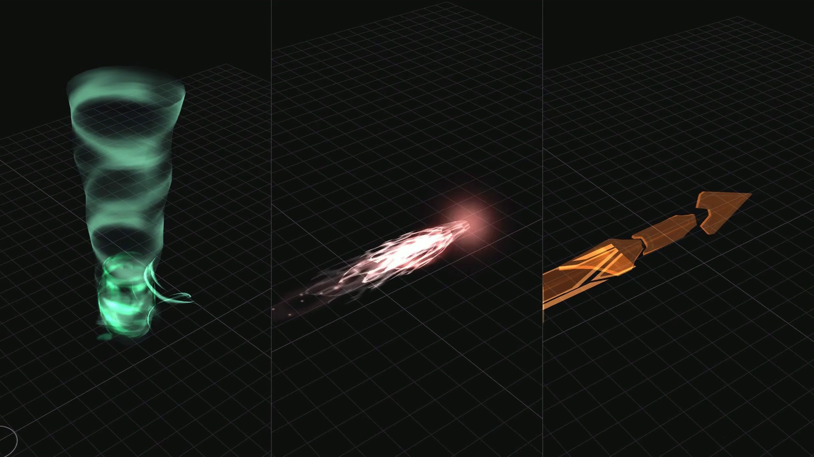

**Preview effect** reproduce una vista previa animada del efecto seleccionado. De izquierda a derecha se ven el tornado jade de Yasuo, el disparo rojo de Ezreal y la flecha ámbar de Ashe.

### Exportar el chroma

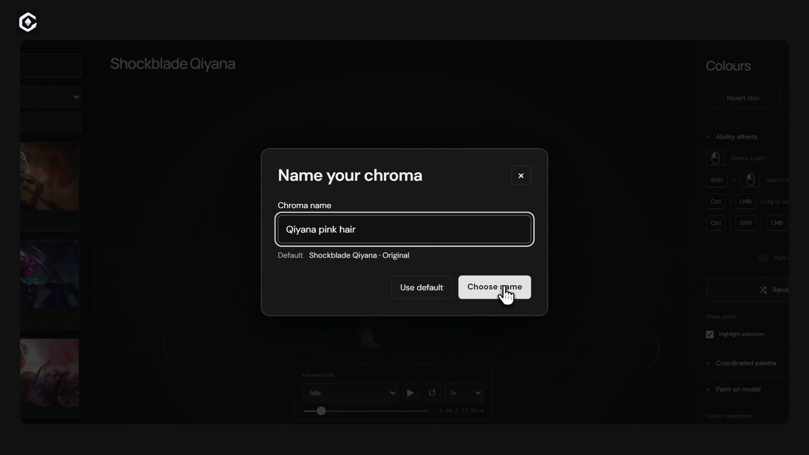

Pulsa **Download .fantome**. Escribe un nombre y confirma con **Choose name**, o selecciona **Use default** para aceptar el nombre sugerido. En la imagen, el archivo se descarga como `Qiyana pink hair.fantome`.

Cada paquete modifica la skin original sobre la que se creó. Para usarlo en partida con un gestor compatible, debes poseer y seleccionar esa skin en el cliente. Consulta el [estado en partida](#estado-en-partida) antes de probar el archivo.

## Ejemplos de chromas

| Kassadin Hextech | Yasuo Dragón de la Verdad | Sylas Freljord |
| --- | --- | --- |
| 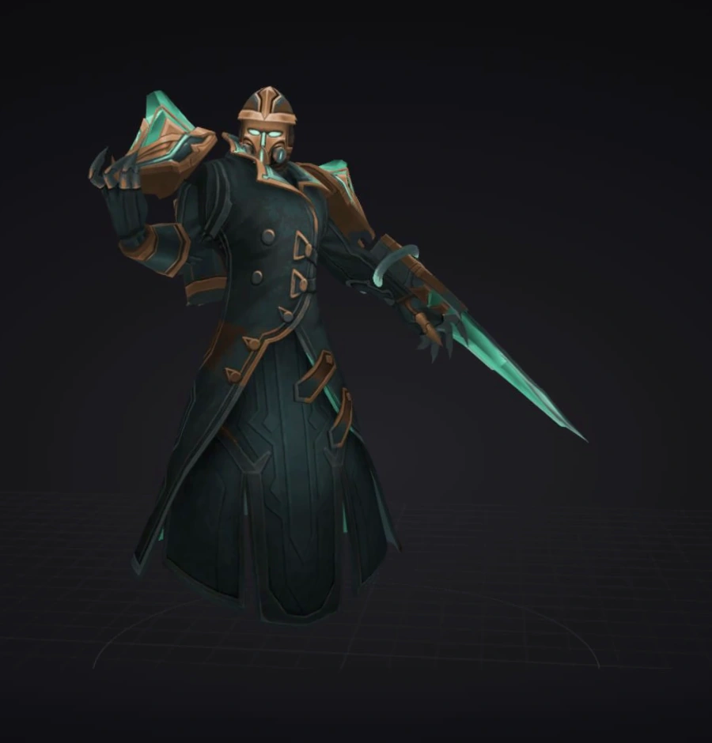 | 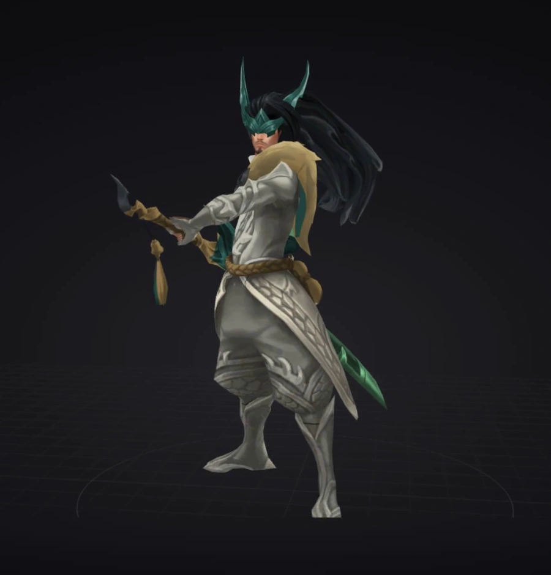 | 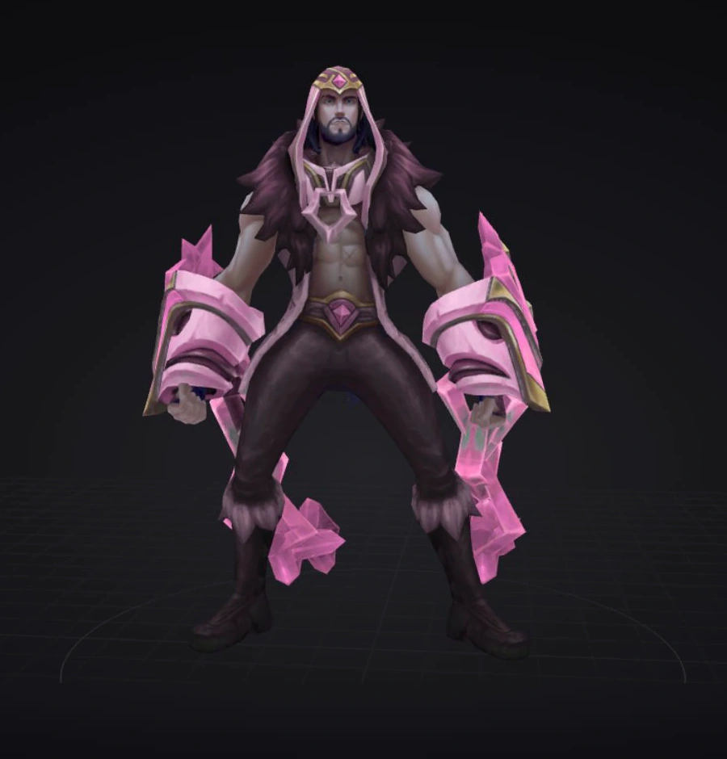 |
| Placas oscuras, cristales verdes y filo esmeralda. | Armadura marfil, pelo oscuro y hoja jade. | Brazales, cadenas y cristales en rosa. |

## Cómo funciona

Las máscaras UV vinculan las piezas de la malla con las áreas correspondientes de la textura. El color se aplica sobre esas áreas conservando el sombreado y el detalle del material. Los perfiles de habilidades identifican qué componentes del efecto se pueden recolorear.

La exportación se ejecuta en un Web Worker del navegador. El exportador conserva el identificador de la skin original y empaqueta las texturas y los parámetros modificados en un archivo Fantome con metadatos y un WAD.

| Carpeta | Contenido |
| --- | --- |
| `web/` | Interfaz, visor 3D y exportador del navegador. |
| `worker/` | Lectura del catálogo y rutas para servir los recursos que usa el editor. |
| `data/` | Índice del catálogo y manifiesto de la Release. |
| `scripts/` | Servidor local, instalador y herramientas de empaquetado. |
| `tests/` | Pruebas de interfaz, catálogo y exportación. |

Ejecuta `npm test` para lanzar las pruebas. Para empaquetar un catálogo ya preparado, `scripts/freeze-index.mjs` genera su índice compacto y `scripts/build-asset-release.py` verifica y divide los recursos en archivos `.tar`. El script de empaquetado requiere Python 3.11 o posterior.

## Créditos

Atelier es un proyecto independiente de fans. Los campeones, skins, modelos, texturas y animaciones pertenecen a Riot Games o a sus licenciantes. Los avisos de componentes de terceros se incluyen en `web/`.
